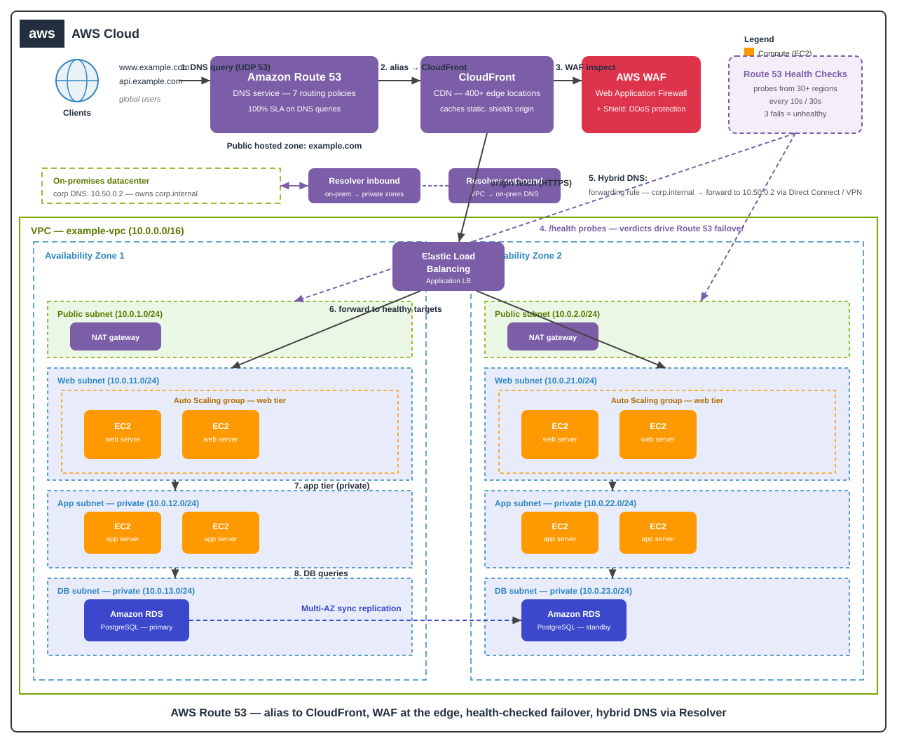

# AWS Route 53 DNS Guide — Routing Policies & Failover Like a Pro


> **TL;DR** — Route 53 is not just "DNS hosting". It is a global traffic-routing
> engine: 7 routing policies, health checks from 30+ edge locations, automatic
> failover, and hybrid-DNS forwarding for on-prem networks. Master the policies
> and you control *where* every user's request lands.

---

## 🗺️ Architecture



The diagram shows a complete production DNS setup: public hosted zone → alias to
CloudFront → WAF → ALB across two AZs, health checks driving **failover routing**
to a DR region, and **Route 53 Resolver** bridging on-premises DNS.

---

## 🧭 Routing policies — the full comparison

| Policy | Answers with | Best for | Gotcha |
|---|---|---|---|
| **Simple** | One static value | `TXT` verification, single endpoint | No health checks — dead endpoint = dead answer |
| **Failover** | Primary until health check fails | Active-passive DR | Needs health checks on **every** record |
| **Geolocation** | Based on user's continent/country | Content licensing, data residency | Accuracy stops at country level |
| **Latency-based** | Lowest-latency region | Global apps, APIs | Routes by *network* latency, not geography |
| **Weighted** | Proportional to weight | Blue-green, canary, A/B tests | Weights ≠ strict percentages (DNS caching) |
| **Geoproximity** | Distance + bias | Tune "how far" traffic travels | Requires Route 53 Traffic Flow |
| **Multivalue answer** | Up to 8 healthy records | Simple client-side load balancing | Each record needs its own health check |

---

## ❤️ Health checks — the failover engine

- Check every **10 or 30 seconds**; mark unhealthy after **3 consecutive failures**.
- Health checkers live in **30+ AWS regions** — one region's outage won't flip your DNS.
- **Calculated health checks** = AND / OR / NOT of up to 256 child checks
  (e.g. "unhealthy if web OR app tier is down").
- Endpoint can be a domain (https://api.example.com/health), IP, or a
  **CloudWatch alarm** (failover on "error rate > 1%", not just "server down").

## 🔗 Alias vs CNAME — know the difference

| | Alias | CNAME |
|---|---|---|
| Points at zone apex (`example.com`)? | ✅ Yes | ❌ No |
| Targets AWS resources (ALB, CloudFront, S3 website)? | ✅ Yes, free of charge | ❌ N/A |
| Health-checked? | ✅ Evaluates target health | ❌ Plain pointer |

## 🏢 Hybrid DNS with Route 53 Resolver

| Endpoint | Direction | Use |
|---|---|---|
| **Inbound** | On-prem → AWS | Your DC's DNS queries `db.internal` in a private hosted zone |
| **Outbound** | AWS → on-prem | EC2 resolves `corp.example.com` via the on-prem DNS |
| **Forwarding rule** | Both | "Send `*.internal` to 10.50.0.2" — no VPN hairpin tricks |

---

## 🐍 Try it: routing-policy lab (no AWS account needed)

`route53_routing_lab.py` simulates all seven policies with health checks:

```bash
python3 route53_routing_lab.py
```

```text
=== Failover policy: primary dies, DNS flips ===
probe 1..3: primary=HEALTHY  -> answer 203.0.113.10 (primary)
probe 4:     primary=UNHEALTHY (3 consecutive failures)
probe 4..6: -> answer 198.51.100.20 (secondary)   # automatic failover

=== Weighted policy: 80/20 canary over 1000 queries ===
blue=803 green=197   (~80/20 as configured)
```

---

## 🧠 Quiz teaser

1. Your `example.com` apex record must point to an ALB. Alias or CNAME?
2. Failover to a DR region just happened, but the primary is back. Does Route 53 flip back automatically?
3. You need "Germany users → Frankfurt, everyone else → Virginia". Which policy?
4. A health check on a CloudWatch alarm fails. What does Route 53 treat the endpoint as?
5. Blue-green deploy needs 90/10 traffic. Which policy, and why isn't it exactly 90/10?

*Answers (collapsed) in [quiz.md](quiz.md).*
